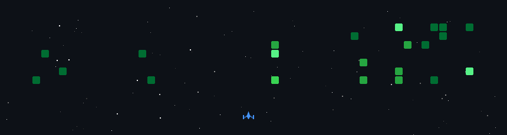

<div align="center">

<!-- HEADER -->


<!-- TYPING SVG -->
[](https://git.io/typing-svg)

</div>

---

<!-- SPACE SHOOTER GAME -->
<div align="center">

## 🎮 My Contribution Space Shooter

> _Watch my GitHub contributions get obliterated in a retro space battle!_



</div>

---

<!-- ABOUT ME -->
## 🧑‍💻 About Me

```python
class Dinesh:
    def __init__(self):
        self.username     = "Dinesh-design786"
        self.role         = "Full Stack Developer"
        self.languages    = ["Python", "JavaScript", "TypeScript", "HTML", "CSS"]
        self.interests    = ["AI/ML", "Web Development", "Automation", "Open Source"]
        self.current_goal = "Building intelligent applications that make a difference"

    def say_hi(self):
        print("Thanks for dropping by! Let's build something awesome together 🚀")

me = Dinesh()
me.say_hi()
```

- 🔭 I'm currently working on **AI-powered projects & Full Stack applications**
- 🌱 I'm currently learning **Machine Learning, Deep Learning & Cloud Technologies**
- 👯 I'm looking to collaborate on **Open Source & innovative projects**
- 💬 Ask me about **Python, React, Node.js, AI/ML, or anything tech**
- ⚡ Fun fact: **My contribution graph is also a Space Shooter game** 🎮

---

<!-- TECH STACK -->
## 🛠️ Tech Stack & Tools

<div align="center">

### 💻 Languages


### 🚀 Frameworks & Libraries


### 🤖 AI & Data Science


### 🗄️ Databases & Tools


</div>

---

<!-- GITHUB STATS -->
## 📊 GitHub Stats

<div align="center">


<br/>


</div>

---

<!-- GITHUB TROPHIES -->
## 🏆 GitHub Trophies

<div align="center">


</div>

---

<!-- CONTRIBUTION SNAKE -->
## 🐍 Contribution Snake

<div align="center">

<picture>
  <source media="(prefers-color-scheme: dark)" srcset="https://raw.githubusercontent.com/Dinesh-design786/Dinesh-design786/output/github-contribution-grid-snake-dark.svg" />
  <source media="(prefers-color-scheme: light)" srcset="https://raw.githubusercontent.com/Dinesh-design786/Dinesh-design786/output/github-contribution-grid-snake.svg" />
  
</picture>

</div>

---

<!-- ACTIVITY GRAPH -->
## 📈 Contribution Graph

<div align="center">

[](https://github.com/ashutosh00710/github-readme-activity-graph)

</div>

---

<!-- CONNECT WITH ME -->
## 🤝 Connect With Me

<div align="center">

[](https://github.com/Dinesh-design786)
[](https://linkedin.com/in/your-linkedin)
[](https://your-portfolio.com)
[](mailto:your-email@gmail.com)

</div>

---

<!-- PROFILE VIEWS -->
<div align="center">


<br/>

### 💜 Thanks for visiting! If you like what you see, give my repos a ⭐

</div>

<!-- FOOTER -->


